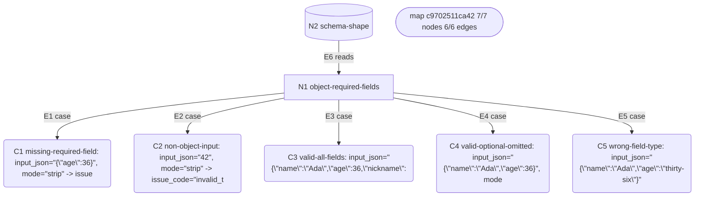

# DRIFT Real-World PR Showcase — Zod (TypeScript + Vitest)

This fork demonstrates **[DRIFT Free (`v0.11.0`)](https://github.com/rad-ox/drift/releases/tag/v0.11.0)** running in live GitHub Actions pull-request checks on a real, non-HTTP TypeScript validation library: **[colinhacks/zod](https://github.com/colinhacks/zod)** (MIT License, pinned upstream base `2a343ed2a4ffbea73fb83862ee1e317662292481`).

- **DRIFT project & release:** [rad-ox/drift (`v0.11.0`)](https://github.com/rad-ox/drift)
- **Important:** All demo PRs target this showcase repository's `main` branch only — never upstream `colinhacks/zod`.

## What `v0.11.0` Enforces Here

- **Hardened observed policy (`.drift/config.toml`):** initialized with `--observed`, enforcing `proof = "verified"` and `require_observations = true` (`pack = "core@1"`, approved by `rad-ox`).
- **Two approved Zod contracts (8 cases total):**
  - `.drift/contracts/object-required-fields.toml` (`zod-parse@1` profile) — 5 cases governing required vs optional properties, field type mismatches, and non-object inputs on `z.object().safeParse()`.
  - `.drift/contracts/object-unknown-keys.toml` (`zod-parse@1` profile) — 3 cases governing `strip`, `strict`, and `passthrough` unknown-key policies.
- **Official JS/TS bridge `v0.11.0` (`tools/drift-bridge/drift.mjs` + `drift.d.mts`):** zero-dependency ESM bridge with full TypeScript declarations, `strictWhen: true` / `DRIFT_STRICT_WHEN=1` input-consumption enforcement, `drift.observation/1` emission (including `checkProjection`), and exact `eq` (`0.3`) checking under Vitest (`zod`, `compile-mode` AOT, and `tsc` typecheck).
- **Single-command gate + independent MIT parity check:**
  ```bash
  nub install --frozen-lockfile

  DRIFT_STRICT_WHEN=1 drift run --events .drift-work/events --gate -- \
    nub exec --node vitest run packages/zod/src/v4/classic/tests/object.drift.test.ts

  drift gate .drift/contracts --events .drift-work/events --json > gate.json
  python3 ~/.local/share/drift/verifier/drift_verify.py .drift/contracts \
    --config .drift/config.toml \
    --events .drift-work/events \
    --compare-gate gate.json --json
  ```

## Contract Map (`drift map .drift/contracts/object-required-fields.toml --as mermaid`)



## Live Demo Pull Requests (against `main`)

Every PR runs two independent GitHub Actions jobs in parallel so you can compare native Vitest against the DRIFT gate directly in the PR Checks panel:

1. **`Native Vitest`** — Runs `object.test.ts` and `object.drift.test.ts` (runtime + `compile-mode` AOT + TypeScript `tsc` typecheck) without the DRIFT gate.
2. **`DRIFT v0.11.0 Gate + Independent MIT Verifier`** — Runs `DRIFT_STRICT_WHEN=1 drift run --events .drift-work/events --gate` and verifies 100% verdict parity against the open MIT reference verifier (`drift_verify.py --compare-gate`).

| PR | Branch | Scenario | Native Vitest | DRIFT v0.11.0 Gate + MIT Verifier |
|---|---|---|:---:|:---:|
| `#1` | `demo/false-green` | Relaxes required `name: z.string()` in `UserProfileSchema` to `name: z.string().optional()` and weakens the `missing-required-field` Vitest check so native Vitest stays green | `PASS` | **`FAIL`** (`bound`, missing observation; parity `ok: true`) |
| `#2` | `demo/valid-fix` | Legitimate behaviour-preserving refactor extracting `formatIssuePath(path)` for nested string, index, and symbol path segments with a focused unit test | `PASS` | `PASS` (`8/8 verified`; parity `ok: true`) |
| `#3` | `demo/free-limit` | **Honest DRIFT Free limit:** keeps the `name: z.string().optional()` regression and feeds hardcoded expected literals into `d.check(...)` without invoking `UserProfileSchema.safeParse(input)` | `PASS` | `PASS` (not blocked by Free alone; parity `ok: true`) |

### Honest Boundary Note on PR `#3` (`demo/free-limit`)

As documented in DRIFT's [`GUARANTEES.md §1.1`](https://github.com/rad-ox/drift/blob/main/GUARANTEES.md) (Vector B), no in-process test protocol alone can stop a contributor or coding agent who has write access to the test file and deliberately feeds hardcoded expected literals into `d.check(...)` without invoking the system under test. Closing that boundary requires keeping acceptance tests outside agent write scope (`CODEOWNERS` / isolated read-only CI harness) and/or enforcing mutation proofs (`proof = "killed"` / `drift mutants --when`) in DRIFT Enterprise.
